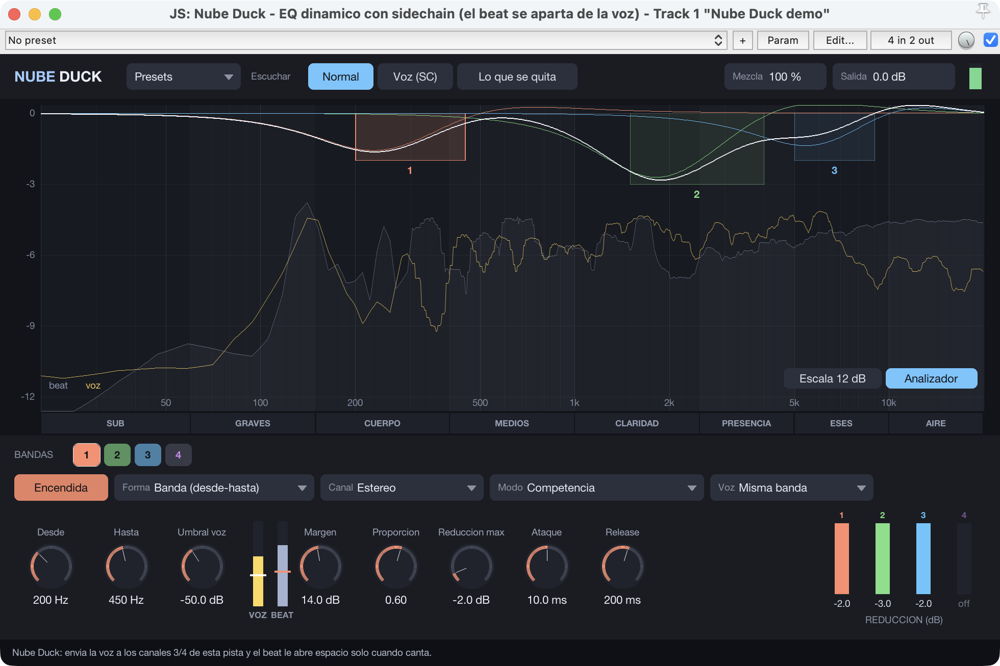

<!-- en -->
# Nube Duck

A free sidechain dynamic EQ for [REAPER](https://www.reaper.fm), written as a JSFX (macOS / Windows / Linux), part of the
[Nube plugins](https://github.com/KevinMeneses/nube-plugins).



Put it on a beat track, send the vocal to channels 3/4, and up to 4 bands of the beat move out of the way **only while
the vocal is there**. Each band has its own range (band / lows / highs / everything), channel (stereo / mid / side),
detection mode, threshold, max reduction, attack and release. Listen to the sidechain or to what is being removed,
solo a band, and watch a gain-reduction meter per band. Fully transparent when nothing is being reduced (bit-identical
output), zero latency.

**Install** — with [ReaPack](https://reapack.com): *Extensions → ReaPack → Import repositories*, paste
`https://github.com/KevinMeneses/nube-plugins/raw/main/index.xml`, then install **Nube Duck**. Or copy `nube_duck.jsfx`
into `REAPER/Effects/Nube Duck/` (on macOS `./install.sh` links it). It shows up as **JS: Nube Duck**. The interface is in Spanish.

**How it was made** — designed and built with [Claude Code](https://claude.com/claude-code). Since an AI can't
listen, every feature is verified by rendering test cases inside REAPER and comparing them sample by sample with a
reference model and with the JSFX it grew from (`tests/run.sh`).

**License** — GPL-3.0-or-later (see `LICENSE`).

---

## Español

EQ dinámico con sidechain para REAPER (JSFX): el beat le abre espacio a la voz **solo mientras suena la voz**.
Nació de `claude_duck_band`, el JSFX que *debía* apartar el Rhodes de la voz en *Nube baja*. Con el preset 1 suena
idéntico a él, muestra a muestra, una vez corregido su error: el original escribía `1e-12`, EEL2 no lee notación
científica, el logaritmo daba NaN y **nunca reducía nada** (su salida es la entrada, bit a bit).


- **Hasta 4 bandas** que se mueven solas. Cada una con:
  - **Forma**: Banda (entre *Desde* y *Hasta*), Graves (todo bajo *Hasta*), Agudos (todo sobre *Desde*) o Todo
    (ducking de la señal completa).
  - **Canal**: Estéreo, Centro (Mid) o Lados (Side). En Centro baja solo lo del medio, donde está la voz, y los lados
    quedan abiertos.
  - **Modo Competencia** (el de `claude_duck_band`): baja solo cuando el beat tapa a la voz *en esa banda*:
    reducción = (nivel del beat − (nivel de la voz − **Margen**)) × **Proporción**. Si el beat ya está bajo la voz,
    no toca nada.
  - **Modo Solo voz**: baja siempre que canta: reducción = (nivel de la voz − **Umbral**) × **Proporción**.
  - **Umbral de voz**: por debajo, la voz no cuenta (ruido, respiraciones, silencio).
  - **Reducción máx**, **Ataque** y **Release**.
  - **Voz detectada en**: la misma banda o la voz completa.
- **Escuchar**: Normal, **Voz (SC)** (lo que entra por 3/4, para revisar el envío) o **Lo que se quita**.
- **Solo** de banda: escuchas solo esa zona del beat.
- **Medidores**: reducción de cada banda en vivo; nivel de la voz con la línea del umbral y nivel del beat con la
  marca *voz − margen* (donde empieza a bajar).
- **Gráfica**: las zonas de las bandas (hasta dónde pueden bajar) se arrastran: bordes = desde/hasta, centro = mover,
  vertical = reducción máx, rueda = ancho. La curva blanca es la reducción de ahora. El analizador muestra el beat
  (relleno) y la voz (línea): donde se juntan es donde chocan.
- **Mezcla** y **Salida**.
- Avisos si la pista no tiene 4 canales o si no llega voz por 3/4.
- Sin reducción la salida es la entrada bit a bit. Sin latencia. CPU: ~1.1 % de un núcleo con 1 banda, ~3.2 % con 4 bandas.

## Instalar

```sh
./install.sh
```

Crea un enlace en `~/Library/Application Support/REAPER/Effects/Nube Duck/`. En REAPER aparece como
**JS: Nube Duck**. Si cambias el código, vuelve a insertar el FX.

## Cómo se usa

1. Pon Nube Duck en la pista del instrumento (Rhodes, guitarra, pads, 808…) o del instrumental completo.
2. En el I/O de esa pista pon **4 canales**.
3. En la pista de la voz crea un envío hacia ella, a los canales **3/4** (en el envío: *Audio → 1/2 → 3/4*).
   Si son varias pistas de voz, un envío por cada una (o desde la carpeta / bus de voces).
4. Elige un preset y mira los medidores de reducción mientras cantas. Con **Lo que se quita** oyes exactamente qué
   se aparta.

| Acción | Cómo |
|---|---|
| Elegir banda | Clic en su número (1–4), en su zona de la gráfica o teclas **1–4** |
| Encender / apagar | Botón *Encendida*, doble clic sobre la zona, **Alt+clic** o tecla **B** |
| Banda nueva | Doble clic en un lugar vacío de la gráfica (enciende la primera banda apagada ahí) |
| Desde / Hasta | Arrastra los bordes de la zona o las perillas |
| Mover / reducción máx | Arrastra la zona: horizontal = frecuencia, vertical = cuánto puede bajar |
| Ancho | Rueda sobre la zona |
| Menú de banda | Clic derecho sobre la zona o su número |
| Solo | Botón *Solo* o tecla **S** |
| Perillas | Arrastra arriba/abajo o usa la rueda; **Shift** = fino; doble clic = valor por defecto |

En el pie de la ventana siempre hay una ayuda de lo que tienes bajo el mouse; las zonas de abajo de la gráfica
explican qué parte de la voz vive en cada frecuencia.

## Presets

| # | Preset | Qué hace |
|---|---|---|
| 1 | Nube baja - Rhodes se aparta de la voz | El `claude_duck_band` del Rhodes de *Nube baja*: 1–4 kHz, margen 14, proporción 0.7, hasta −4 dB, 5/120 ms |
| 2 | Rhodes / piano - hueco en el centro | 1–4 kHz solo en el centro hasta −5 + caja 200–450 −2.5 |
| 3 | Guitarra (reggaetón / R&B) | 1.2–3.5 kHz −4 + 250–500 −2 |
| 4 | Pads / coros - atrás de la voz | 300 Hz–3 kHz en el centro −6 (lento) + 3–8 kHz −3 |
| 5 | Lead / melodía (trap) | 1.5–5 kHz −6, rápido + 300–700 −2 |
| 6 | Campanas / kalimba / plucks | 2–6 kHz −5 |
| 7 | 808 / bajo - deja el cuerpo de la voz | 150–300 Hz −4 |
| 8 | 808 drill (glides) - suave | 100–250 Hz −3, lento |
| 9 | Hi-hats - no tapan las s | Agudos desde 6 kHz −6, 1/60 ms |
| 10 | Instrumental completo - 3 bandas | cuerpo 200–450 −2, claridad 1.5–4k −3, s 5–9k −2 |
| 11 | Instrumental completo - solo el centro (M/S) | lo mismo pero solo en el centro |
| 12 | Dancehall - órgano y stab | 500 Hz–2.5 kHz −4 + 2.5–5k −2.5 |
| 13 | Reggaetón - beat completo suave | 150–350 −2 + centro 1–4k −3 |
| 14 | Rap rápido - reacción corta | 1–4 kHz −4, 2/60 ms |
| 15 | Voz cantada / R&B - lento | 800 Hz–4 kHz −4 + 200–400 −2, 20/300 ms |
| 16 | Ad-libs / dobles | en la pista de ad-libs, con la voz principal en 3/4: 1.5–4k −6 + 200–500 −4 |
| 17 | Reverb / delay de la voz | en el retorno de reverb/delay con la voz seca en 3/4: todo −8 al cantar, vuelve en 300 ms |
| 18 | Hablado / intro | el beat entero baja hasta −6 mientras hablas |
| 19 | Tag / drop | ducking clásico: todo −12, rápido |
| 20 | Lo-fi - sutil | 1–4 kHz −2, lento |
| 21 | Por defecto | banda 1 = 1–4 kHz como el original; bandas 2–4 apagadas |

Los presets también se eligen desde la lista de parámetros de REAPER ("Cargar preset").
Para guardar los tuyos usa el botón **+** de la ventana del FX.

## Estructura

- `src/nube_duck.template.jsfx`: el código (DSP + interfaz). **Editar aquí.**
- `tools/build.py`: genera `nube_duck.jsfx` (declara los 59 sliders y el acceso por índice).
- `tests/`:
  - `model.py`: modelo de referencia en Python (mismo orden de operaciones que el JSFX) y el `claude_duck_band`
    original.
  - `cases.py`: los casos (los usan el script de REAPER y el chequeo; los presets se leen de la plantilla).
  - `run.sh`: arma el plugin, renderiza 49 casos en una pestaña propia de REAPER (WAV float) y los compara:
    todos los casos y los 21 presets contra el modelo (idénticos bit a bit), sin voz / voz bajo el umbral = entrada
    bit a bit, el preset 1 contra el original corregido (idéntico, también en 20 s del instrumental y la voz reales
    de *Nube baja*) y la reducción en régimen contra la fórmula (±0.05 dB). También informa que el original tal cual
    no hace nada.
  - `perf.lua`: CPU. `ui_demo.lua` / `ui_close.lua`: demo con la ventana abierta.

## Detalles técnicos

- Filtros SVF trapezoidales (Simper), Butterworth de 2.º orden, los mismos coeficientes que `claude_duck_band`.
  La banda es LP(hasta) − LP(desde); Graves = LP(hasta); Agudos = x − LP(desde); Todo = x.
  Salida = x − banda·(1 − g): con g = 1 (sin reducción) es exactamente la entrada. Como la banda es una resta de
  filtros de 2.º orden, la caída real es más ancha que la zona marcada y a los lados hay un realce de ~+0.3 dB:
  la curva blanca de la gráfica es esa respuesta exacta, no una aproximación.
- Detector RMS de 10 ms del beat en la banda (mono o Mid/Side) y de la voz (en la banda o completa); la reducción
  en dB se suaviza con ataque/release de un polo. Las bandas van en serie.
- Cambios de frecuencia: con el transporte detenido se aplican de golpe; sonando se deslizan en ~30 ms.
- Parámetros por script: slider N = parámetro N−1; banda b (1–4), parámetro p (0–12) = slider 11 + 13·(b−1) + p.
  Desde/Hasta, Ataque y Release van **normalizados** (forma log; fórmula en `tests/render_cases.lua`).
  "Cargar preset" = slider 7.

Nota sobre las pruebas: necesitan REAPER y Python con numpy, scipy y soundfile
(`NUBE_PY=/ruta/a/python tests/run.sh`). El caso con material real usa grabaciones propias que no están en el repo.
